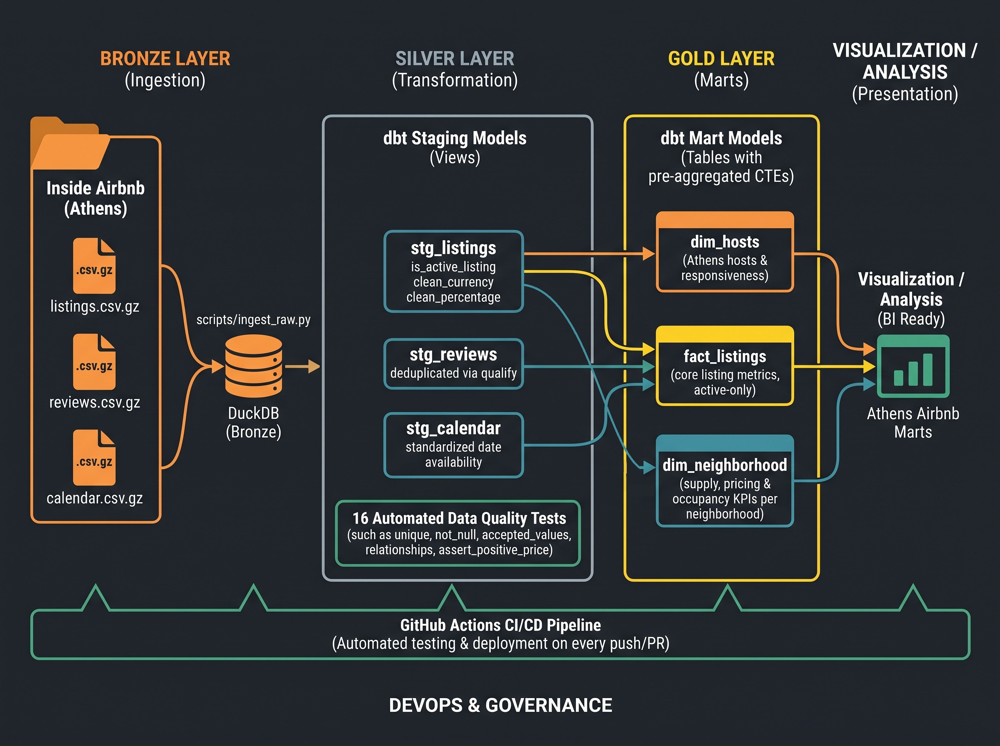

# 🏛️ Athens Airbnb Analytics Engineering Pipeline (dbt + DuckDB)
[](https://github.com/alexvks22/athens-airbnb-dbt-pipeline/actions/workflows/ci.yml)

An end-to-end **Analytics Engineering** pipeline implementing the **Medallion Architecture (Bronze → Silver → Gold)** on real-world Athens short-term rental data using **dbt-core**, **DuckDB**, and **GitHub Actions CI/CD**.



## 🎯 Business Problem & Data Quality Discoveries
Raw short-term rental datasets from **Inside Airbnb (Athens - September 2026)** exhibit authentic real-world data engineering challenges that must be resolved before executive BI reporting:
* **Dirty String Formats:** Nightly prices stored with `$` and commas (e.g., `"$1,250.00"`), and host response/acceptance rates containing `%` and `'N/A'` strings.
* **Inactive Listings vs. Historical Reviews:** 920 listings in the raw dataset have `NULL` prices (unlisted/inactive properties), yet still link to **29,732 historical reviews**. Dropping them in staging would break referential integrity.
* **Duplicate Records & Fan-Out Risks:** Duplicate `review_id` entries in raw reviews and 1-to-many join fan-out risks when combining listings with 365-day calendar availability.

## 🏗️ Architecture & Modeling Decisions
* **Bronze Layer (`bronze` schema):** Raw compressed `.csv.gz` files (`listings.csv.gz`, `reviews.csv.gz`, `calendar.csv.gz`) ingested directly into **DuckDB** via Python (`scripts/ingest_raw.py`) without manual decompression.
* **Silver Layer (`models/staging/` — Views):**
  * Standardized data types and cleaned currency/percentage strings using reusable **Jinja macros** (`clean_currency.sql`, `clean_percentage.sql`).
  * Deduplicated reviews using window functions (`QUALIFY ROW_NUMBER()`).
  * Preserved all listings while introducing an `is_active_listing` boolean flag (`price is not null`) to maintain referential integrity with historical reviews.
* **Gold Layer (`models/marts/` — Tables):**
  * `dim_hosts`: Unique Athens hosts with superhost status and responsiveness metrics.
  * `fact_listings`: Core fact table filtering active listings (`is_active_listing = true`) and safely joining pre-aggregated review and calendar CTEs to prevent fan-out.
  * `dim_neighborhood`: Executive summary table of listing supply, average nightly USD price, occupancy potential, and guest ratings across Athens neighbourhoods.
* **Data Quality & CI/CD:** 16 automated dbt tests (`unique`, `not_null`, `accepted_values`, `relationships`, plus a custom singular test `assert_positive_price.sql`) executed via **GitHub Actions** on every push and Pull Request.

## 📊 Data Source & Download Instructions
This project uses the official **Inside Airbnb** open dataset for **Athens, Attica, Greece** for September 2026:
* **Dataset Portal:** [Inside Airbnb – Get the Data](https://insideairbnb.com/get-the-data/)

### How to get the files:
1. Navigate to [https://insideairbnb.com/get-the-data/](https://insideairbnb.com/get-the-data/) and scroll down to **Athens, Attica, Greece**.
2. Download the **detailed** (compressed `.csv.gz`) files—not the summary `.csv` files:
   * `listings.csv.gz` *(Detailed Listings data)*
   * `reviews.csv.gz` *(Detailed Review Data)*
   * `calendar.csv.gz` *(Detailed Calendar Data)*
3. Create the directory `data/raw/` in the root of this repository and place all three `.csv.gz` files inside it:
   ```text
   data/raw/
   ├── listings.csv.gz
   ├── reviews.csv.gz
   └── calendar.csv.gz
   ```
   *(Note: `data/raw/` and `*.duckdb*` are excluded via `.gitignore` to keep the repository lightweight.)*

## 📂 Repository Structure
```text
athens-airbnb-dbt-pipeline/
├── .github/workflows/ci.yml       # Automated dbt build & test CI pipeline
├── docs/architecture.png          # End-to-end architecture diagram
├── macros/
│   ├── clean_currency.sql         # Jinja macro stripping '$' and ',' to DECIMAL
│   └── clean_percentage.sql       # Jinja macro handling 'N/A' and '%' to DOUBLE
├── models/
│   ├── staging/                   # Silver layer views, sources, and schema tests
│   └── marts/                     # Gold layer dimensional star schema & KPIs
├── scripts/
│   └── ingest_raw.py              # Loads raw .csv.gz files into DuckDB Bronze
├── tests/
│   └── assert_positive_price.sql  # Custom singular SQL validation test
├── dbt_project.yml
└── profiles.yml
```

## 🚀 How to Run Locally
1. **Clone the repository and install dependencies:**
   ```bash
   git clone https://github.com/alexvks22/athens-airbnb-dbt-pipeline.git
   cd athens-airbnb-dbt-pipeline
   pip install dbt-duckdb duckdb
   ```
2. **Download the raw Athens datasets:**
   Follow the instructions in the [Data Source & Download Instructions](#-data-source--download-instructions) section above to populate `data/raw/`.
3. **Load Bronze tables into DuckDB:**
   ```bash
   python scripts/ingest_raw.py
   ```
4. **Verify connection and run the full pipeline (transformations + 16 data quality tests):**
   ```bash
   python -m dbt.cli.main debug --profiles-dir .
   python -m dbt.cli.main build --profiles-dir .
   ```